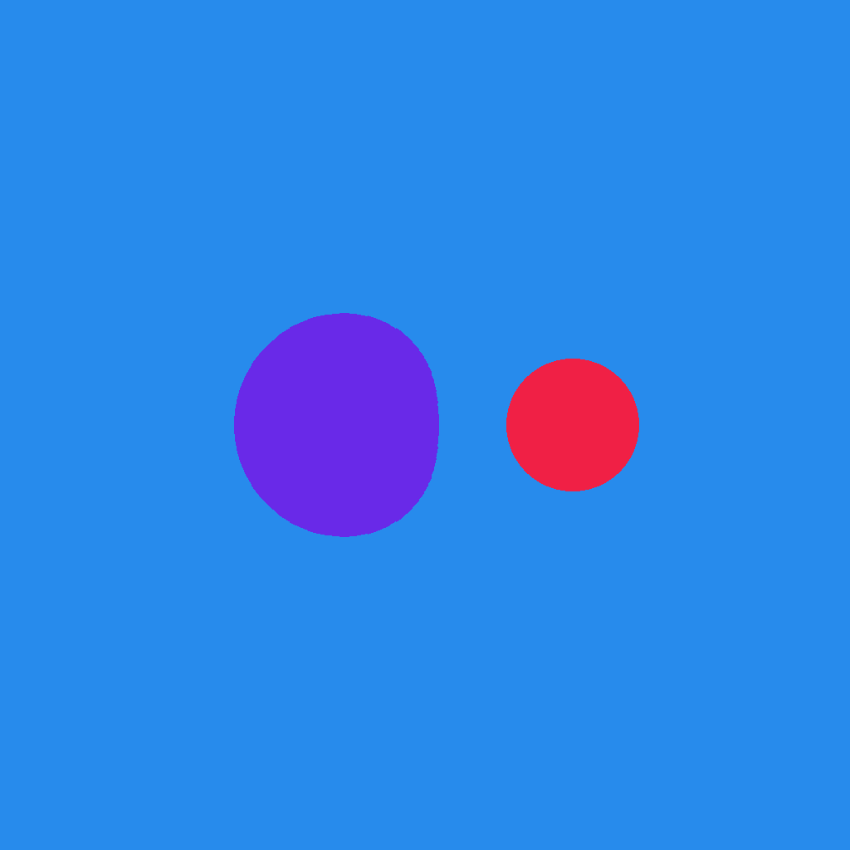
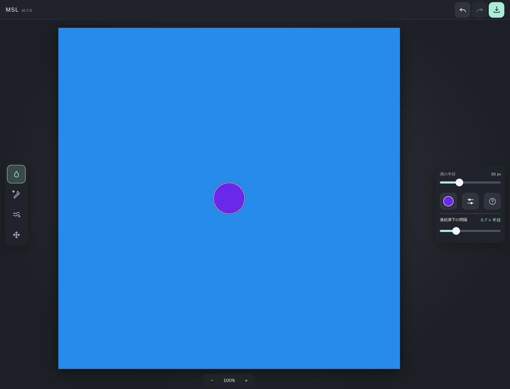
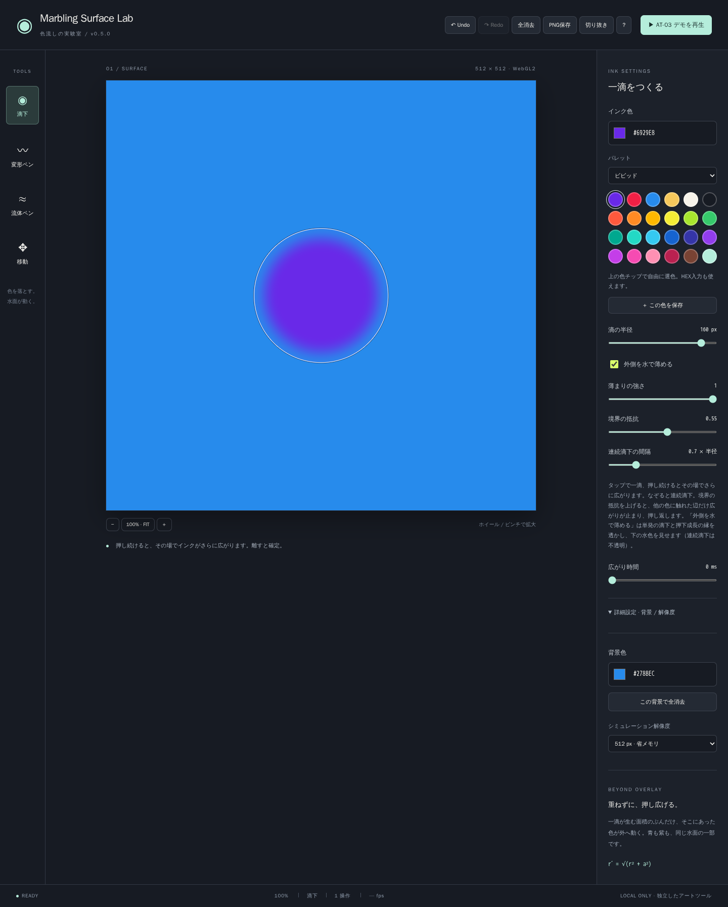

# Marbling Surface Lab

**現在のバージョン：0.7.1** — [変更履歴](CHANGELOG.md)

仕様書 **v0.1** を唯一の初期要件にした、ブラウザ内で動く色流しプロトタイプ。React + TypeScript + Vite + WebGL2。M0〜M1を先に実装・検証し、[M1品質記録](docs/M1-validation.md)を残してからM2〜M4を実装した。

**新しい円を重ね描きするのではなく、背景を含む旧水面全体を押し出す。**

色流しの操作、連続滴下、押下成長、色ごとのインク粘度・表面張力、外側が水で薄まる任意の透過表現、変形ペン、流体ペン、Undo/Redo、全体PNG、任意領域の切り抜きPNGをブラウザ内で扱う。画像は端末内で生成し、共有メニューで選んだ場合だけ共有先へ渡す。



## 起動

Node.js **22.12以降**（検証環境22.22.3）、npm、WebGL2対応ブラウザ。

```bash
npm ci
npm run dev
```

`http://localhost:5173/MSL/` を開く。開発サーバーはLANにも公開するため、同じネットワークのタッチ端末ではPCのIPアドレスでアクセスできる。省メモリで起動する場合は `http://localhost:5173/MSL/?resolution=512`。

```bash
npm run build
npm run preview -- --host 0.0.0.0
```

本番ビルドは `dist/`。静的ホスティングのビルドコマンドは `npm run build`、公開ディレクトリは `dist`。サブディレクトリ配信では `npm run build -- --base=/your-path/`。バックエンド・認証・分析SDK・外部フォントは不要。作品や操作を外部へ送信しない。

### GitHub Pagesへ公開

`vite.config.ts` の `base` はリポジトリ名に合わせて `/MSL/` に設定済み。
`.github/workflows/deploy.yml` が `main` へのpushまたは手動実行で、Node.js 22 / `npm ci` / ビルド / Pagesへのデプロイを行う。

1. GitHubの `konjomitsuki/MSL` → **Settings → Pages → Build and deployment → Source** で **GitHub Actions** を選ぶ。
2. プロジェクトのルートに `package.json`・`package-lock.json` と今回の設定を含めてpushする。

   ```bash
   git add .
   git commit -m "Setup GitHub Pages"
   git push origin main
   ```

   このコマンドはGit初期化・`origin`設定済みの `main` ブランチで実行する。未設定の場合は先にGitHubのリポジトリへ接続する。
3. **Actions** タブでビルド・デプロイの成功を確認する。

公開先：**https://konjomitsuki.github.io/MSL/**（Pages有効化・デプロイ成功後）。
リポジトリ名を変更する場合は `base` とテストの配信URLも変更する。

## AT-03の確認

1. **「設定」→「▶ AT-03 デモを再生」**を押す。
2. 青 `#278BEC` の1024基準の水面へ、紫 `#6929E8` / `(420,512)` / 半径130、続いて赤 `#F02045` / `(690,512)` / 半径80を450msずつで投入する。
3. 右から **赤 → 連続した青 → 変形した紫** を確認する。
4. 赤をさらに落とすと、既存の赤・青・紫が再び押し出される。「変形ペン」で境界を横切ってドラッグすると、青と紫の境界も伸びる。

紫右端は、赤を落とす前の550から約528.75へ移る。
中心線の **x=540は紫から青へ変わり、x=531〜607は連続した青**。
単純なオーバーレイではx=540が紫のままなので、このテストを通らない。
赤を同じ位置にもう1滴追加すると紫右端は約510へ移ることも検証する。

- [デスクトップ画面](docs/at-03-desktop.png)
- [押し続けた滴の成長](docs/press-growth.png)
- [切り抜き画面](docs/crop-desktop.png)
- [タッチ操作後のモバイル画面](docs/mobile.png)

デモは新規作品として開始する。既存作品がある場合は履歴の置き換えを確認する。

## 操作・実装済みP0

| 操作 | 方法 |
|---|---|
| 滴下 | 水面をクリック / タップ。色・HEX・半径・広がり時間を調整。押し続けると同じ滴がその場で成長 |
| インク物性 | 色ごとに粘度0.2〜3・表面張力0.3〜1.5を設定し、実効半径・広がり時間・押下成長へ反映。設定は色ごとに保存 |
| 水で薄める | 「外側を水で薄める」を有効化。滴の縁ほど表示アルファが下がり、背景の水色が透ける。単発の滴下と押下成長に適用 |
| 連続滴下 | 滴下ツールでドラッグ。指の軌跡に沿って一定間隔で滴下。間隔は半径の0.3〜2倍（最小8px）。軌跡全体を1回でUndo |
| 色 | ビビッド24色・パステル18色・アース18色・モノクロ12色。任意のHEX / ピッカー。保存色はブラウザ内に最大24色 |
| 変形ペン | 選択後ドラッグ。初期半径80・強度1.2、最大半径240・強度3。カーソルで半径を表示 |
| 流体ペン | 選択後ドラッグ。周囲を巻き込みながら移流し、指を離しても0.2〜2秒の余韻。「流れを止めて確定」で停止 |
| 移動 | 移動ツール / Space＋ドラッグ / 2本指 |
| ズーム | ホイール / ピンチ / ＋−。FITで全体表示 |
| Undo / Redo | 上部ボタン / Ctrl・Cmd＋Z / Ctrl・Cmd＋Shift＋Z |
| 全消去 | 確認後、選択した背景へ戻す。Undo可能 |
| PNG保存 | UI・カーソル・表示ズームを除いた水面全体を保存 |
| 切り抜きPNG | 枠を移動・リサイズし、自由/1:1/4:3/3:4/16:9/9:16と出力幅を指定して保存 |
| 512px省メモリ | 詳細設定で切替。確認後に新しい作品へ移行 |

マウス・タッチとも、押すとその場で滴が広がり始め、離すと1操作として確定する。選択半径に達した後も押し続けると、同じ中心・同じ色のまま最大180pxまで成長する。短いタップでも選択半径までは同じ固定スナップショットからアニメーションして到達する。5 CSS pxを超えて動かすと連続滴下へ移行する。連続滴下中は広がり時間を使わず即時確定して追従する。停止した指の下に自動で滴を増やすことはない。2本指へ移行した場合と `pointercancel` は未確定の滴・軌跡・ペン操作を開始前へ戻す。連続滴下を開始する際、先行するタップの滴下アニメ・キューは最終半径で完了させる。通常のタップは最大10件をキューに保持する。色・半径・間隔等はジェスチャー開始時に固定する。

### インクの物性（色ごと）

滴下設定の「インクの物性」では、色ごとに **粘度** と **表面張力** を保存できる。値は実測された物理量ではなく、色ごとの相対的な材料差を表す係数で、ブラウザの `localStorage` に最大24色分を保持する。

- 実効半径 = 選択半径 ÷ √表面張力（4〜180px）
- 実効広がり時間 = 設定時間 × 粘度 × √表面張力（0〜4500ms）
- 押下成長速度 = 基準速度 × 1 /（粘度 × 表面張力）

表面張力が低い色（界面活性剤が多い色）ほど、同じ半径設定でも大きく広がる。粘度が高い色はゆっくり広がり、押し続けたときの追加成長も遅い。色IDによる境界抵抗は使わず、**色そのものではなく材料差**として滴下の大きさ・速さ・押し出す量を変える。既存色の RGB は混ぜず、Jafferの逆写像で水面全体を押し出す。



このモデルは表面張力・粘度・膜厚・表面圧を連立して解くものではない。実際のマーブリングで見られる「色によって広がり方が違う」「古い膜を押す量が変わる」という傾向を、少数の係数で再現する近似である。詳細なレオロジー計算は行わない。

### 水で薄める

滴下設定の「外側を水で薄める」を有効にすると、滴の中心は不透明のまま、縁に向かって表示アルファが滑らかに下がる。強さは0.1〜1で調整でき、強いほど縁が透ける。押し続けた成長に併用できる。

透明度は計算用水面のRGBラベルを変えず、表示時だけアルファとして適用する。そのため色同士を混ぜたり、選択していない中間色を生成したりはしない。透けた部分からは現在の背景色（水面の水色）が見える。全体PNG・切り抜きPNGでは背景色と合成して、アルファ255の通常PNGとして保存する。

連続滴下は、隣り合う滴の透明な縁が重なって縞状になるため、このオプション中も不透明の軌跡として描く。単発の滴下・押し続けの成長で水彩的な縁を得るための表示オプションである。



流体ペンは余韻まで含めて1操作。流れが止まるとUndo・PNG保存が使える。次の滴下やペン操作を始めると、その時点の流れを確定する。色の保存だけは `localStorage` を利用し、作品は自動保存しない。

スマートフォンでは下部の4つのツールで切り替え、半径をその場で調整できる。「カラー」「設定」はボトムシートで開く。タブレットとPCでは水面の横に調整項目を配置する。色番号（HEX）、4種類のパレット、保存色に加え、最近選んだ7色を利用できる。

[UI刷新の検証記録](docs/ui-renewal-validation.md)に、Figmaとの差分、参照ガイド、画面幅別の確認結果をまとめた。

## iPhoneの「写真」に保存

上部の「⤓」→「写真に保存・共有」→「共有メニューを開く」→「画像を保存」の順に選ぶと、iPhoneの「写真」アプリで画像を見られる。プレビュー画像の長押しからも「写真に保存」または「画像を保存」を選べる。共有機能が使えないブラウザでは長押しを案内する。長押しメニューが出ない場合はSafariで開く。

「PNGをファイルに保存」は従来どおり「ファイル」やダウンロードフォルダへの保存。ブラウザから「写真」へ自動で書き込むことはできず、共有メニューか長押しメニューで保存を選ぶ必要がある。共有をキャンセルしてもダウンロードは始まらず、プレビューからやり直せる。

## 切り抜きPNG

上部の「⤓」から「切り抜きPNG」で水面に選択枠を表示する。枠内をドラッグして移動し、四隅のハンドルでリサイズする。比率は自由・1:1・4:3・3:4・16:9・9:16から選べ、固定比率ではリサイズ時に縦横比を保つ。X・Y・幅・高さの数値入力、出力幅64〜2048pxの指定にも対応し、高さは選択比率から自動計算する。

「切り抜きPNG」はUI・枠・カーソル・表示ズームを含めず、選択した水面領域だけを書き出す。出力画素が切り抜き元の画素サイズと同じ場合は再サンプリングせず、1画素ずつ正確にコピーする。拡大・縮小する場合はCanvas 2Dの高品質補間を使うため、境界に補間色が入り得る。切り抜き範囲は作品データや履歴には保存しない。

切り抜き設定の「写真に保存・共有」から、選択した範囲と出力サイズのPNGを「写真」に保存できる。「切り抜きPNG」はファイルとしてダウンロードする。

- [切り抜き画面（デスクトップ）](docs/crop-desktop.png)
- [切り抜き画面（モバイル）](docs/crop-mobile.png)

## 描画設計

Jafferの **Dropping Paint** の面積保存型変換に基づき、独自にGLSLを実装。

```text
d = length(Q - C)
d < a : 新色
d ≥ a : 旧水面の C + (Q-C) × sqrt(d²-a²)/d を読む
```

- 2枚のRGBA8テクスチャをピンポン。描画先のテクスチャを同じパスで参照しない。
- アニメーション中は片方を**固定した滴下前スナップショット**として扱い、もう片方にプレビューを上書きする。半径は `a × (1-(1-t)³)`。最終フレームでだけ交換する。スナップショット専用の3枚目は不要。
- **色の参照はNEAREST**。ブレンディング・ディザリングは無効。表示パスだけ色境界を補間し、表示結果を次の計算に戻さない。
- 変形ペンは線分からの距離によるGaussian変位場。約3σで打ち切り、変位を最大2テクスチャpx、点間距離を半径/3以下に分割。入力イベント間の残距離を保持して等間隔に補間する。色をステップごとに丸める代わりに、**16bit×2の逆参照座標マップを累積**し、操作開始時の固定画像から色を読む。座標だけを補間するため、小さい移動が蓄積し、長く引き延ばせる。
- 流体ペンは独自実装の **64×64 CPU流速場**。半ラグランジュ移流、指の軌跡による運動量入力、40回Jacobi反復の圧力投影、壁で法線速度ゼロ、減衰を計算する。GPUは流速を読み、固定1/60秒の中点逆追跡で座標マップを移流する。RGBA色の拡散・混色は行わない。流体計算の各ステップの入力を履歴へ記録し、余韻も同じ手順で再生する。
- 連続滴下も各滴に同じJaffer逆写像を使用。単なる線・円のオーバーレイではない。イベントの頻度ではなく軌跡の長さで滴の間隔を決める。
- 押し続けの滴下は、滴下前の固定スナップショットに毎フレーム異なる半径の逆写像を適用するだけ。フレームを累積しないため、押下時間とフレームレートで最終形状が変わらない。離した時点の半径を通常の1つの `drop` 操作として履歴へ記録する。
- 色ごとのインク物性は、正規化した粘度・表面張力から実効半径 `r/√σ`、実効時間 `t·μ·√σ`、押下成長速度 `1/(μσ)` を求める。滴下操作には確定時点の物性をスナップショットとして記録するため、色を切り替えてもUndo/Redo・コンテキスト復帰の再演算結果は変わらない。色IDで境界を検出する処理は行わない。
- 水で薄める表現は、滴内部のRGBを固定したまま、中心から縁への正規化距離に応じてアルファだけを最大90%下げる。計算用テクスチャはRGBA8のまま維持し、表示パスで背景色と合成する。透明度を次の滴下の色サンプリングへ持ち込まないため、滴下を重ねても色ラベルは混ざらない。PNG書き出し時は背景を先に敷いて合成する。
- 仮想座標・半径は512pxモードでも1024基準。CSS座標、DPR、表示ズーム・移動を分離する。リサイズは表示バッファだけを変更する。
- 履歴は最大50操作。8操作ごとにCPUチェックポイント、通常は最大4個＋最古の基準画像。古い操作を捨てる際は基準画像へ焼き込む。Undoは最寄りチェックポイントから再演算する。
- 滴下だけならGPUテクスチャ2枚・8MiB（512px時2MiB）。最初のペン操作で固定画像＋座標マップ2枚を確保し、計5枚・20MiB（512px時5MiB）を再利用。流体ペンではさらにRG32F流速テクスチャ1枚・32KiB。浮動小数点レンダーターゲット拡張は不要。履歴画像は通常最大20MiB（512px時5MiB）。`navigator.deviceMemory ≤ 4` が得られる端末ではチェックポイントを2個に減らす。CPU流速配列・ストロークの退避画像・読出し用一時配列・画面バッファ・ログは別途必要。
- 切り抜きは選択範囲を仮想1024座標で保持し、実際のシミュレーション解像度へ換算してCPU画素から直接生成する。等倍出力は補間なし、リサイズ時のみCanvas 2Dの高品質補間を使う。
- WebGL context lost時は未確定入力を破棄。ブラウザが復帰イベントを通知すれば、GPUリソースを再作成して確定済み履歴を再構築する。

## テスト

```bash
npm test
npx playwright install chromium
npm run test:e2e
npm run build
```

Linuxでブラウザ依存ライブラリが不足する場合は `npx playwright install --with-deps chromium`。
E2Eは実際のChromium/WebGL2を使用し、この環境ではSwiftShaderで実行する。シェーダーのモックではない。

v0.1.0では単体テスト9件・E2E11件でM0〜M4を検証。v0.2.0では流体の圧力・減衰・再現性の単体テストと、色保存、長いペン、流体、連続滴下のGPU・UIテストを追加。v0.3.0では押下時間による成長・短いタップ・キャンセルの単体/E2E、境界抵抗の方向別減速と非混合のGPUテストを追加。v0.4.0では切り抜き範囲のクランプ・比率・リサイズ・出力高さの単体テストと、枠ドラッグで描画されないこと、16:9の出力寸法・3色の画素・モバイルレイアウトのE2Eを追加。v0.5.0では水で薄める表示の縁アルファ減少・RGB非混合・背景との表示合成・PNGの不透明合成・UIからの有効化をE2Eで追加。v0.5.1ではJafferの式との対応を文書化し、ページスクロール後のマウス座標テストを実表示位置の再取得で安定化。v0.6.0では色IDの境界抵抗を廃止し、色ごとの粘度・表面張力の正規化、実効半径・時間・成長速度、localStorage保存、材料差による滴下半径・押し出し量の変化、リロード復元を単体/E2Eで追加。

**v0.6.0最終検証：単体19/19、E2E24/24、TypeScript・本番ビルド成功。**

| 受け入れ基準 | 検証内容 |
|---|---|
| AT-01 | 円内部・外部・指定位置のGPU画素 |
| AT-02 | 半径60→80で旧円外縁が約100 |
| AT-03 | UIから固定シナリオ、連続青領域・旧紫領域の変位、追加滴下 |
| AT-04 | 投入順を逆にして画像が変わる |
| AT-05 / 06 | 背景を含むペン変形、計算結果は投入済みの3色だけ |
| AT-07 | 即時描画とアニメ最終画像が全RGBA画素で一致 |
| AT-08 | 滴下・1ストローク・全消去のUndo / Redo、分岐・キャンセル |
| AT-09 | ズーム時のマウス座標、DPR 2のタップ・実ブラウザの2指イベント・変形、ピンチで滴下しない |
| AT-10 | UIからPNGダウンロード、デコードした全画素が未拡大の512px水面と一致 |
| AT-11 | 1024pxへ100滴、テクスチャ生成/解放を監視、50回Undo / Redo、FPS計測 |
| AT-12 | ビューポート変更前後で計算用水面が不変 |

追加：履歴上限・チェックポイント破棄、入力密度を変えたストロークの一致、キュー上限、WebGL2非対応表示、強制コンテキスト消失からの復帰。

v0.2.0追加：圧力投影による発散低減、入力後の慣性と減衰、400pxのペン追従、弱い細ペンの変位蓄積、流体の色非混合・Undo/Redo画素一致・キャンセル・コンテキスト復帰、512/1024pxの流体処理、連続滴下の密度非依存・既存色の移動・軌跡単位の履歴、タッチの連続滴下とピンチ取り消し、パレット・任意HEX・保存色の再読込。

v0.3.0追加：押し続けた滴の時間比例成長、短いタップの選択半径への到達、押下キャンセル、実マウスでの押下とタップの差、境界抵抗あり/なしで接触側だけが後退し自由側は変わらないこと、旧色の押し出し量の減少、計算用水面が3色のままであること。

v0.4.0追加：切り抜き枠の移動・リサイズ・比率固定・端でのクランプ、枠操作中に滴下しないこと、16:9・320×180px出力のPNG寸法、選択範囲内の紫・青・赤が元のRGBで含まれること、切り抜き後も操作数が変わらないこと、モバイルで横スクロールしないこと。

v0.5.0追加：水で薄める有効/無効で縁の表示が変わること、中心は不透明で縁ほどアルファが下がること、計算用水面と表示画素のRGBが元の滴色のままであること、透明縁が背景色と合成されること、保存PNGが背景合成済みのアルファ255になること、UIのチェックと強さスライダー。

開発時だけ `window.__lab` を公開して、GPU画素・履歴・リソースを検証する。本番ビルドでは公開しない。

## Jafferの式との対応

Jafferの [Dropping Paint](https://people.csail.mit.edu/jaffer/Marbling/Dropping-Paint) と [The Mathematics of Marbling](https://people.csail.mit.edu/jaffer/Marbling/Mathematics) を実装と照合した結果を、一致・拡張・近似に分けて記録する。

| 対象 | 判定 | 内容 |
|---|---|---|
| 新滴の内部 | 一致 | `d < a` の画素は新色。境界 `d = a` は外側として旧水面の中心を参照する。 |
| 外側の逆写像 | 一致 | `C + (Q-C) * sqrt(d²-a²)/d`。Jafferのラスタ用逆写像と同じ式。 |
| 全色への同一変形 | 一致 | 背景・既存インク・以前の滴を区別せず、同じ座標変換を適用する。 |
| 滴下順序 | 一致 | 新しい滴が直前までの水面全体を変形する。結果は `F_n ∘ … ∘ F_1` に対応する。 |
| 最後の滴の円形 | 一致（材料1・薄めOFF） | 最後の滴は円形で、以前の滴だけが非円形になる。 |
| 円環の面積保存 | 一致（材料1） | `r'² = r² + a²`。単体テストで半径60・80から外縁100、および複数半径の円環面積を検証。 |
| 滴下アニメ・押下成長 | 最終状態は一致 | 固定した滴下前画像へ半径だけを変えた逆写像を毎フレーム適用する。最終フレームは同じ半径の1回の滴下と一致。 |
| 連続滴下 | 数学的には滴下列 | 各サンプルが通常のJaffer滴下。同一色の滴が重なるため、1本のティーン操作ではなく波紋状の見た目になる。 |
| 色ごとのインク物性 | **拡張** | 粘度・表面張力から実効半径・時間・成長速度を変える。Jafferの幾何変形自体は変えず、滴の半径と時間へ材料差を写像する。 |
| 外側を水で薄める | **拡張** | 幾何変形ではなく表示用アルファ。Jafferの不透明な絵具にはない。初期値OFF。PNGでは背景を合成する。 |
| 変形ペン | **近似（Jafferの式ではない）** | 仕様書§4.4のGaussian変位場。Jafferの直線ティーンは `P + z·u^d·M` の指数減衰。線分・3σ打切り・2テクセル上限も追加。 |
| 流体ペン | **別モデル** | 64×64の圧力投影付き流速場。Jafferのティーン変換ではなく、独自の非圧縮近似。 |
| 有限キャンバス | 仕様上の割切り | Jafferは無限平面。画面外へ出た領域は切り捨て、再流入させない。 |

**純粋なJaffer滴下の確認条件**：滴下ツールでインク粘度と表面張力をともに1.0にし、「外側を水で薄める」をOFFにする。AT-03デモは色ごとの物性を指定しないため、内部では材料1.0・薄めOFFの純粋な滴下を使う。変形ペンと流体ペンは、それぞれ仕様上の近似・別モデルであり、Jafferのティーン式の実装ではない。

### 性能記録

測定条件・数値は [docs/performance.json](docs/performance.json) に保存し、負荷E2E実行時に更新する。
最終測定：Linux / Headless Chromium 159 / SwiftShader / 1024px。

- 100滴後もGPUテクスチャ **2枚**（滴下用ダブルバッファ）、追加生成なし。
- 保持操作数50、履歴画像20MiB以内。
- 20滴ごとの確定処理は約131〜542ms。50操作超では最古操作の基準画像への焼き込みが加わる。
- 最後の1500ms滴下プレビューは約60fps。開発モードの下部表示は**直近の滴下アニメーションの平均FPS**。
- 50回Undoで50滴時点に戻り、50回Redoで100滴時点の画素ハッシュと一致。

これはソフトウェアGPUの測定。一般PC・スマートフォン実機での30fps達成は未確認。ペンの負荷は1イベント当たりの線分数にも依存する。

流体の512pxでの実行記録：[docs/fluid-performance.json](docs/fluid-performance.json)、[流体による変形画像](docs/fluid-demo.png)。CPUとソフトウェアGPUの短い操作でのフレーム間隔を記録する。低速環境で計算の追いつき処理を1描画あたり最大3ステップに抑えるため、余韻の実時間が設定より延びる場合がある。

## 既知の制限・判断

1. **WebGL2必須**。Canvas2Dフォールバックは採用せず、利用不可時は対応ブラウザ・アクセラレーション設定を案内する。
2. 有限キャンバスの外へ押し出された領域は失われ、再流入しない。閉じた水槽の面積収支を厳密に補正しない。
3. 変形ペンは視覚的ワープ。流体ペンは圧力投影を用いた軽量な2D非圧縮近似で、実際の水・インクの厳密再現ではない。64×64の速度場では小さな渦は解像できない。輪郭の階段化、細い帯の消滅、端の引き延ばし、近似による面積誤差が起こり得る。座標マップも16bitの有限精度（1024基準で約0.016px）を持つ。色ごとの粘度・表面張力は滴の実効半径・時間・成長速度へ写像する相対的な演出値で、実測したレオロジーではない。色境界ごとの表面圧・膜の押し合い・界面活性剤の移流は解いていない。押し続けの成長上限は180px。
4. 化学混色、色の自然拡散、実測レオロジー、筆圧、櫛・渦巻きは未実装。色ごとの粘度・表面張力の数値は相対的な近似で、実材料の測定値ではない。自律的な動きは流体ペンの操作中と余韻の間だけ。速度場は各流体操作の開始時に初期化する。流体の筆跡は入力タイミングの影響を受けるが、保存したステップ列のUndo/Redoは同じ画像になる。「水で薄める」は計算用の色を変えず表示時だけアルファを下げる近似で、物理的な希釈・層の重なり・透明インクの混色を解いてはいない。透けた部分には現在の背景色が見える。連続滴下は縞状の縁を避けるため不透明で描く。
5. PNGは計算用の正確なRGBを優先し、表示用AAは含めない。512pxモードの全体出力は512×512。切り抜きの等倍出力は補間しないが、拡大・縮小出力はCanvas 2D補間により境界へ中間色が入り得る。2048px再描画はないため、元のシミュレーション解像度を超える細部は増えない。水で薄める表示は保存時に背景色と合成され、透過チャンネルを持つPNGにはならない。
6. 作品の自動保存・JSON保存・読込はない。ページ終了・再読み込み・解像度変更で作品と履歴は失われる。切り抜き範囲も保存しない。必要な画像はPNG保存する。保存色はこのブラウザの同一オリジンの `localStorage` のみで保持し、他端末との同期はしない。
7. 確定前の滴下・待機キュー・ストロークはコンテキスト消失時に破棄する。ブラウザが復帰できない場合は再読み込みが必要。シェーダー・GPUメモリ確保失敗も画面に表示する。
8. メモリ制限は画素配列の容量と端末メモリ情報による保守的な上限管理。GPUの空き容量を正確に取得する標準APIはない。長いストローク・履歴再演算時には一時的に重くなる場合がある。
9. Chromium自動テストとモバイルエミュレーションを実施。Safari / Firefox、iOS / Android実機、スタイラス実機、GPU横断の完全な画像一致は未検証。

## 主なファイル

```text
src/app/                    React画面・レスポンシブCSS
src/components/             色・詳細設定
src/model/                  型・初期値・固定デモ
src/core/                   実行制御、滴下式、色ごとのインク物性、ストローク補間、CPU流体ソルバー
src/render/                 WebGLリソースとGLSL
src/input/                  Pointer Events、ピンチ、座標変換
src/history/                上限付き履歴・チェックポイント
src/export/                 水面画素からのPNG生成、切り抜き範囲の計算
src/tests/                  数学・履歴・入力の単体テスト
e2e/                        実GPU画素とUIの受け入れテスト
docs/                       品質記録・スクリーンショット・性能測定
```

## 出典と独立性

数理モデルの出典：[Aubrey Jaffer — Dropping Paint](https://people.csail.mit.edu/jaffer/Marbling/Dropping-Paint)、[The Mathematics of Marbling](https://people.csail.mit.edu/jaffer/Marbling/Mathematics)。
UI・TypeScript・GLSL・テストは本プロトタイプ向けの独自実装で、第三者のソースコードをそのまま転用していない。React等のライブラリはnpm依存として使用する。

DWS JAPANの色流し表現に着想を得た独立したアートツールであり、公式・提携製品ではない。独自レシピ・装置・内部工程の再現を主張しない。第三者の作品画像・ロゴは使用していない。
